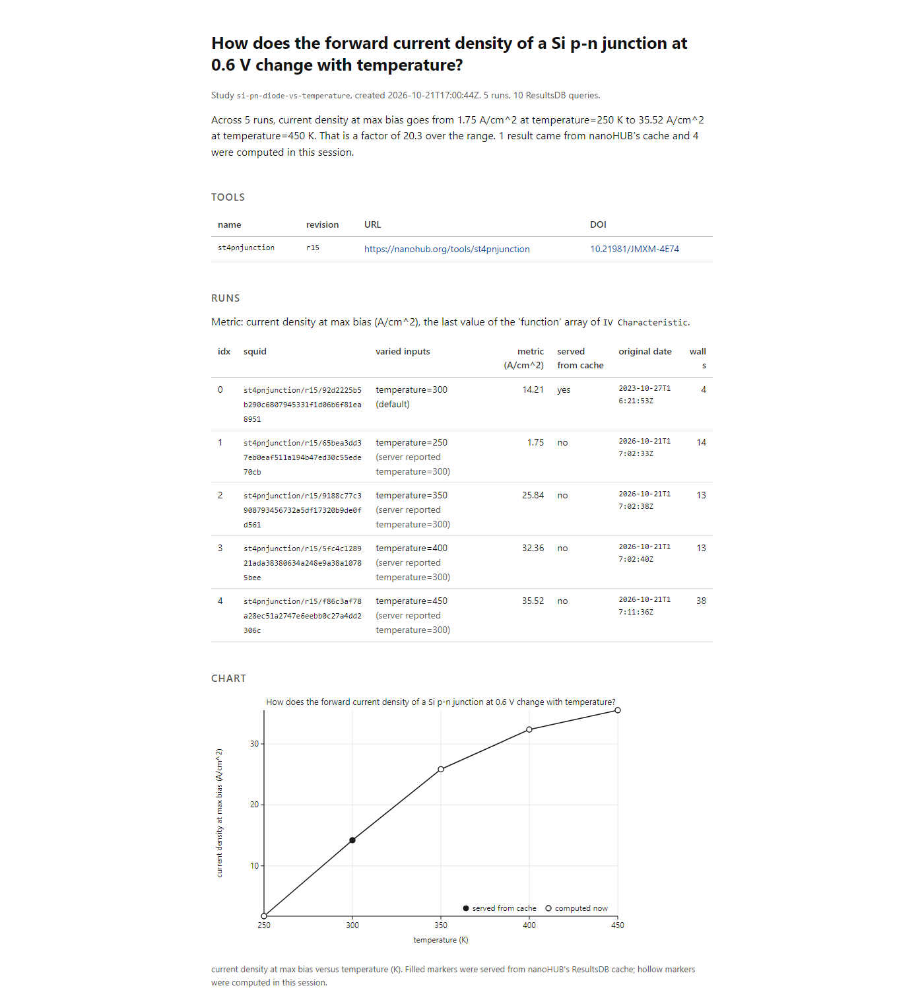

# runcard

> Independent project built on nanoHUB's AURA MCP during the OSI Hackathon 2026.

runcard turns a nanoHUB simulation session driven through the AURA MCP server into a study record
that a person can read (`card.html`), a machine can verify (`ro-crate-metadata.json`, `study.json`)
and an agent can re-execute and compare (`rerun.json`, `compare.md`). It is a zero-dependency Python
package plus a Claude Code skill that tells the agent when to query, when to stop and ask, and what
to log.



## Why

An LLM agent that runs simulations on nanoHUB leaves behind a chat transcript. The transcript does
not say which exact inputs reached the tool, which ResultsDB record (squid) answered, whether that
record was computed now or years ago, or how to run the same study again. The AURA preprint lists
session retention and provenance-aware error handling as future work; runcard is a client-side
answer to both. Every run is recorded with its chosen inputs, the inputs the server reported, the
squid and tool revision, the metric, and evidence for whether nanoHUB served it from its cache.
Every ResultsDB query is kept too, because the pre-run query is the only place where the original
computation date of a cached result is visible.

## What already exists and how this builds on it

- **RO-Crate 1.1 and the Workflow Run Crate profiles.** runcard writes `ro-crate-metadata.json`
  following RO-Crate 1.1 and the Process Run Crate profile (the member of the Workflow Run Crate
  family for runs that are not driven by a workflow engine): one `SoftwareApplication` per nanoHUB
  tool (url, revision, DOI), one `CreateAction` per run (instrument, `PropertyValue` inputs with
  `unitText`, metric result, start and end time, squid as identifier, action status, the person and
  the LLM client as agents) and `File` entries for the card, the plan and the raw payloads.
- **W3C PROV and PROV-AGENT.** PROV gives the entity / activity / agent vocabulary and PROV-AGENT
  extends it to AI agents. runcard uses the schema.org flavour of the same ideas (through RO-Crate)
  so the record can be read by RO-Crate tooling without a PROV toolchain; the mapping is direct
  (CreateAction = Activity, PropertyValue = Entity, Person and SoftwareApplication = Agent).
- **AURA's own workflow history trace.** `get_aura_dashboard_state` records which tools were called
  and when, shared across MCP clients. It does not record chosen inputs, result ids, metric values or
  a way to re-execute. runcard stores the trace id (`aura_trace_id`) so the two records point at each
  other and adds what the trace leaves out.

## Install and use

Python 3.10 or newer, nothing else at runtime. Tests need pytest.

```
git clone https://github.com/antoniolleitao/runcard && cd runcard
python -m pytest -q          # 35 offline tests
python -m runcard --help
```

Commands (`python -m runcard <cmd>`):

| command | what it does |
|---|---|
| `init "<question>" --dir studies/<slug> [--model ID] [--author NAME] [--metric metric.json]` | creates `study.json` |
| `add-tool --dir D --metadata metadata.json --tool NAME [--doi DOI]` | snapshots `get_tool_metadata`, adds the nanoHUB URL |
| `set --dir D [--aura-trace-id ID] [--resultsdb-utc-offset-hours H] [--rerun-of SLUG]` | records the AURA trace id, overrides the ResultsDB clock offset, links a rerun to its original study |
| `log-run --dir D --tool T --chosen-inputs ci.json --chosen-outputs co.json --requested-at ISO [--completed-at ISO] --result result.json` | parses a `get_job_result` payload, strips `inline_files`, caps arrays and strings, computes the metric |
| `log-query --dir D --tool T --filters filters.json --csv data.csv --purpose "<text>"` | records a `get_data_from_nanohub` query and its rows' squid, revision and date |
| `provenance --dir D` | marks each run as served from cache, computed now, or unverified |
| `build --dir D` | writes `card.md`, `card.html`, `chart.svg`, `ro-crate-metadata.json`, `rerun.json`, `methods.txt` |
| `rerun-plan --dir D` | prints the ordered steps of `rerun.json` |
| `compare --dir D --new-dir D2` | pairs runs by chosen inputs, classifies them, writes `compare.md` |

The skill in `.claude/skills/runcard/SKILL.md` is the procedure the agent follows in any AURA MCP
session: init, tool metadata and DOI, an exact-match ResultsDB query before every run (an existing
point proceeds with a note of its first computation date, a new point stops and asks for approval,
never more than five unapproved runs), run and fetch once, a second exact-match query after the run
so the new squid and its date are on record, then provenance, build and the card. "rerun" replays
`rerun.json` into a new directory and compares.

The demo study is in `studies/si-pn-diode-vs-temperature` (card: `card.html`), its re-execution in
`studies/si-pn-diode-vs-temperature-rerun`, and the comparison in `compare.md` in both.

## Observations on AURA MCP v2.0.0

Facts observed on 2026-10-21 with the st4pnjunction Sim2L (r15), ordered by impact. Evidence
files quote the saved payloads and query CSVs under `studies/si-pn-diode-vs-temperature/raw/`.

1. **Concurrent run_sim2l calls returned the same payload for every request.** Four jobs submitted in one turn
   all came back with the 300 K result although three asked for 250, 350 and 400 K; new ResultsDB
   rows for 250, 350 and 400 K appeared during the batch, but the returned envelopes did not
   correspond to the requests.
   Evidence: `docs/evidence-parallel.md`; steps: `scripts/repro_parallel.md`.
2. **`simulation_inputs` lists tool defaults, not the submitted values.** For a 250 K run the YAML
   says `temperature: value: 300` while the `Parameters` output and the PADRE deck say 250; true for
   all 13 payloads of the session. Evidence: `docs/evidence-inputs.md`.
3. **A result carries no cache signal and no date.** A run with all-default inputs returned a
   2023-10-27 result (squid `92d2225b...`) with nothing in the response saying it was stored, or
   when; only the ResultsDB query before the run, or the stamp inside the Output Log, reveals it.
   Evidence: run 0 in `docs/evidence-dates.md` and `docs/evidence-parallel.md`.
4. **ResultsDB `date` values are 7 h behind UTC** with no zone marker, so a naive comparison
   turns every fresh run into an apparent cache hit. Evidence: `docs/evidence-dates.md`.
5. **`find_novel_datapoints` returns output that does not match its declared schema**; the server
   reported "structured content that violates its outputSchema: $.candidate should be object, got NoneType", while the dashboard
   trace shows the check completed server-side (checked_candidates 2, all previously simulated).
   Reproduce with two candidate points that already exist, for example temperature 300 and 350.
6. **File outputs come back inline although they were not requested.** With `chosen_outputs
   ["IV Characteristic", "Parameters"]` every payload carried `inline_files["Output Log"]`
   (about 217 KB) and `inline_files["Padre Input Deck"]` (30 KB) next to the `artifacts` and
   `resource_links` for the same files; each `get_job_result` was 246 to 259 KB for a 21-point
   curve. Evidence: the `_runcard_note` and `artifacts` entries in `raw/run-*.json` (inline content
   stripped) and `docs/excerpts/run-250K-job-788e8f2e-inline-files.txt`.
7. **Dashboard trace status and labelling drift from the session.** The labelled trace
   (`b1f321c9...`, created by `search_nanohub_tools` with `workflow_label`) stopped after the
   metadata calls; all runs and queries were recorded under a separate unlabelled "Scientific
   workflow" trace (`b7298f71...`), and an earlier trace (`dee0dbaa...`) still reported
   `status: running` 45 minutes after its last event. Observed through
   `get_aura_dashboard_state(trace_id="latest")` at 16:59, 17:12 and 17:15 UTC.

## License

MIT, see `LICENSE`.
