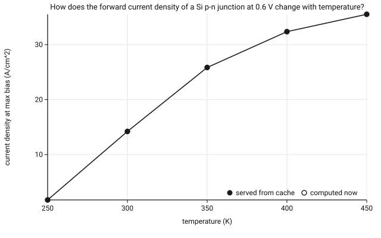

# How does the forward current density of a Si p-n junction at 0.6 V change with temperature?

Across 5 runs, current density at max bias goes from 1.75 A/cm^2 at temperature=250 K to 35.52 A/cm^2 at temperature=450 K. That is a factor of 20.3 over the range. 5 results came from nanoHUB's cache and 0 were computed in this session.

## Tools

| name | revision | URL | DOI |
|---|---|---|---|
| `st4pnjunction` | r15 | https://nanohub.org/tools/st4pnjunction | 10.21981/JMXM-4E74 |

## Runs

Metric: current density at max bias (A/cm^2), the last value of the 'function' array of `IV Characteristic`.

| idx | squid | varied inputs | metric | served_from_cache | original_date | wall_seconds |
|---|---|---|---|---|---|---|
| 0 | `st4pnjunction/r15/65bea3dd37eb0eaf511a194b47ed30c55ede70cb` | temperature=250 (server reported temperature=300) | 1.75 | yes | 2026-10-21T17:02:33Z | 27 |
| 1 | `st4pnjunction/r15/92d2225b5b290c6807945331f1d06b6f81ea8951` | temperature=300 (default) | 14.21 | yes | 2023-10-27T16:21:53Z | 8 |
| 2 | `st4pnjunction/r15/9188c77c3908793456732a5df17320b9de0fd561` | temperature=350 (server reported temperature=300) | 25.84 | yes | 2026-10-21T17:02:38Z | 12 |
| 3 | `st4pnjunction/r15/5fc4c128921ada38380634a248e9a38a10785bee` | temperature=400 (server reported temperature=300) | 32.36 | yes | 2026-10-21T17:02:40Z | 13 |
| 4 | `st4pnjunction/r15/f86c3af78a28ec51a2747e6eebb0c27a4dd2306c` | temperature=450 (server reported temperature=300) | 35.52 | yes | 2026-10-21T17:11:36Z | 12 |

## Chart



## Methods

We asked: How does the forward current density of a Si p-n junction at 0.6 V change with temperature?

Using the nanoHUB tool st4pnjunction (revision r15, https://nanohub.org/tools/st4pnjunction, DOI 10.21981/JMXM-4E74) through the AURA MCP server, we submitted 5 simulation requests varying temperature over {250, 300, 350, 400, 450} K, with all other inputs at their tool defaults. For each run we requested the outputs 'IV Characteristic', 'Parameters'. The reported metric is current density at max bias (A/cm^2), computed as the last value of the 'function' array of the 'IV Characteristic' output.

Of the 5 successful runs, 5 were served from nanoHUB's ResultsDB cache (originally computed on 2023-10-27, 2026-10-21), 0 were computed during this session.

Requests were submitted between 2026-10-21T17:12:32Z and 2026-10-21T17:14:47Z by Claude Code (claude-fable-5-1) on behalf of Antonio Leitao. Each run is identified by its ResultsDB squid; the ordered re-execution plan is in rerun.json (runcard 0.1.0).

## Provenance

- AURA trace id: `b7298f71-7271-4977-b0c4-e1cd4504260b`
- Study created: 2026-10-21T17:11:43Z
- Runs requested: 2026-10-21T17:12:32Z to 2026-10-21T17:14:47Z
- Agent: Claude Code (claude-fable-5-1)
- Author: Antonio Leitao
- Provenance computed: 2026-10-21T17:22:52Z; cached 5, fresh 0, unverified 0
- ResultsDB date offset applied: -7 h (calibrated against simulator log stamps)
- Re-execution of study `si-pn-diode-vs-temperature`; runs whose squid appears there are marked served from cache
- Simulator log stamps (from returned files): run 0: 2026-10-21T17:02:19Z, run 1: 2023-10-27T16:21:35Z, run 2: 2026-10-21T17:02:21Z, run 3: 2026-10-21T17:02:22Z, run 4: 2026-10-21T17:11:23Z
- Queries logged: 10; raw payloads under `raw/`

## How to re-run

```
python -m runcard rerun-plan --dir studies/si-pn-diode-vs-temperature-rerun
```

Execute each step through the AURA MCP server in order (see rerun.json), log the results into a new study directory, then `python -m runcard compare --dir <this> --new-dir <new>`.
